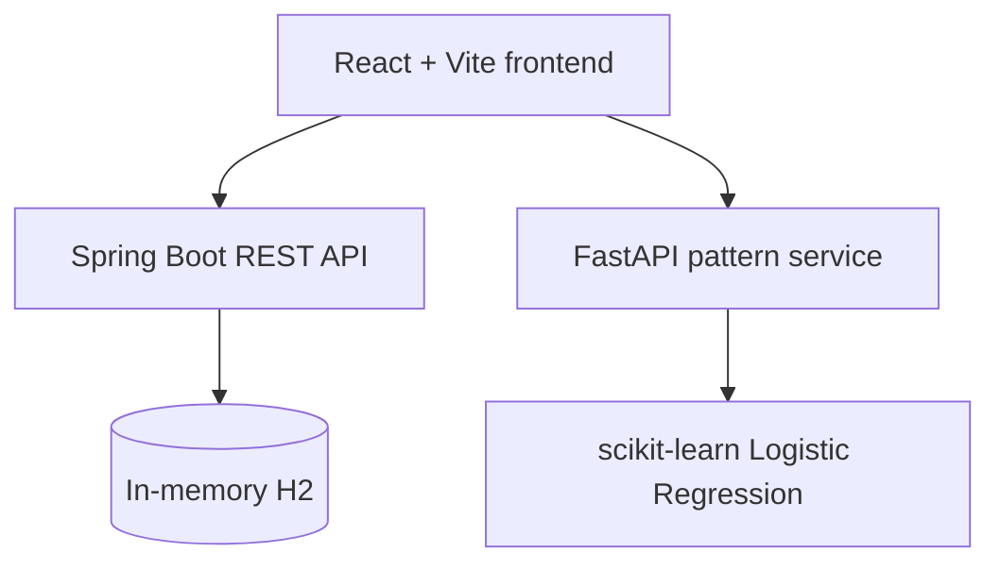

# Sanjeevani

Sanjeevani is an AI-assisted personal health journal for recording everyday wellness, vital readings, and symptoms. A small machine-learning service can identify patterns in symptom names based on its training data.

> **Responsible use:** Sanjeevani is a portfolio demo, not a medical diagnosis system and not a source of medical advice. Pattern results describe the model's training data; they are not medical conclusions. Consult a qualified healthcare professional about health concerns, and do not enter sensitive personal health information.

## Live Demo


- **Application:** [sanjeevani-hazel.vercel.app](https://sanjeevani-hazel.vercel.app/)
- **Backend health:** [sanjeevani-backend-xbst.onrender.com/api/health](https://sanjeevani-backend-xbst.onrender.com/api/health)
- **ML service health:** [sanjeevani-ml.onrender.com/health](https://sanjeevani-ml.onrender.com/health)

## Screenshots

Add your screenshots under `docs/screenshots/`, then replace the comments below with Markdown image links. For example: ``.

### Dashboard

<!-- Add the dashboard screenshot here. -->

### Profile setup

<!-- Add the profile setup screenshot here. -->

### Wellness and health logs

<!-- Add a wellness, vitals, or symptoms screenshot here. -->

### Symptom patterns

<!-- Add the symptom pattern analysis screenshot here. -->

## Features

- Create a demo profile in the browser
- Record wellness details such as sleep, hydration, mood, stress, and activity
- Track vital readings and symptoms
- Review dashboard totals, recent entries, and a sleep trend
- Request dataset-based symptom-pattern classification
- See model metadata, confidence, and unrecognized symptom names

## Architecture



## Tech Stack

- **Frontend:** React, Vite, lucide-react
- **Backend:** Java 21, Spring Boot, Spring Data JPA, Spring Security
- **Backend storage:** H2 in-memory database
- **ML service:** Python, FastAPI, scikit-learn, joblib

## Run Locally

Requirements: Java 21 or newer, Python, and Node.js/npm.

Start each component in a separate PowerShell terminal from the repository root.

### 1. Backend

```powershell
Set-Location backend/backend
./mvnw.cmd spring-boot:run
```

The backend starts at `http://localhost:8080`. It uses embedded H2; no database server or database credentials are required.

### 2. ML service

```powershell
Set-Location ml-service
python -m venv .venv
./.venv/Scripts/Activate.ps1
pip install -r requirements.txt
$env:PORT = "8000"
uvicorn main:app --host 0.0.0.0 --port $env:PORT
```

The ML service starts at `http://localhost:8000`. It provides `GET /health` and `POST /predict`.

### 3. Frontend

```powershell
Set-Location frontend
Copy-Item .env.example .env.local
npm install
npm run dev
```

Vite prints the local frontend URL. The example environment file points the frontend to the local backend and ML service. Override `VITE_API_BASE_URL` or `VITE_ML_BASE_URL` in `.env.local` if your services use different URLs.

## API Overview

| Method | Path | Purpose |
| --- | --- | --- |
| GET | `/api/health` | Backend health check |
| POST | `/api/users` | Create a demo user profile |
| POST, GET | `/api/profile`, `/api/profile/{id}` | Create or retrieve a health profile |
| POST, GET | `/api/wellness` | Create or list wellness logs |
| POST, GET | `/api/vitals` | Create or list vital logs |
| POST, GET | `/api/symptoms` | Create or list symptom definitions |
| POST, GET | `/api/symptom-logs` | Create or list symptom logs |
| GET | `/api/dashboard` | Dashboard totals and latest entries |
| GET | `/health` | ML service health check |
| POST | `/predict` | Classify a symptom-name pattern |

## Deployment

### Frontend — Vercel

- Set the project root to `frontend`.
- Build command: `npm run build`.
- Output directory: `dist`.
- Set `VITE_API_BASE_URL` to the deployed backend base URL, such as `https://sanjeevani-backend-xbst.onrender.com`.
- Set `VITE_ML_BASE_URL` to the deployed ML service base URL, such as `https://sanjeevani-ml.onrender.com`.
- Redeploy the frontend after changing Vite environment variables.

### Backend — Render

- Use a Docker web service with root directory `backend/backend`; the included Dockerfile builds and runs the Java 21 application.
- Set `CORS_ALLOWED_ORIGIN` to the exact frontend origin: `https://sanjeevani-hazel.vercel.app`.
- Render supplies `PORT`.
- No `DB_URL`, `DB_USERNAME`, or `DB_PASSWORD` is needed for the current in-memory H2 configuration.

### ML service — Render

- Set the service root directory to `ml-service`.
- Install dependencies with `pip install -r requirements.txt`.
- Start with `uvicorn main:app --host 0.0.0.0 --port $PORT`.
- Set `CORS_ALLOWED_ORIGIN` to the exact Vercel frontend origin.
- Keep the model files in `ml-service/models/`.

## Demo Limitations

- The backend uses an **in-memory database**. Profiles and journal entries are cleared whenever the backend restarts or redeploys.
- The demo has no sign-in or per-user access controls. User IDs are stored in the current browser.
- Do not use the app to store real or sensitive health information.
- Model output is a dataset-based pattern classification, not a diagnosis.
